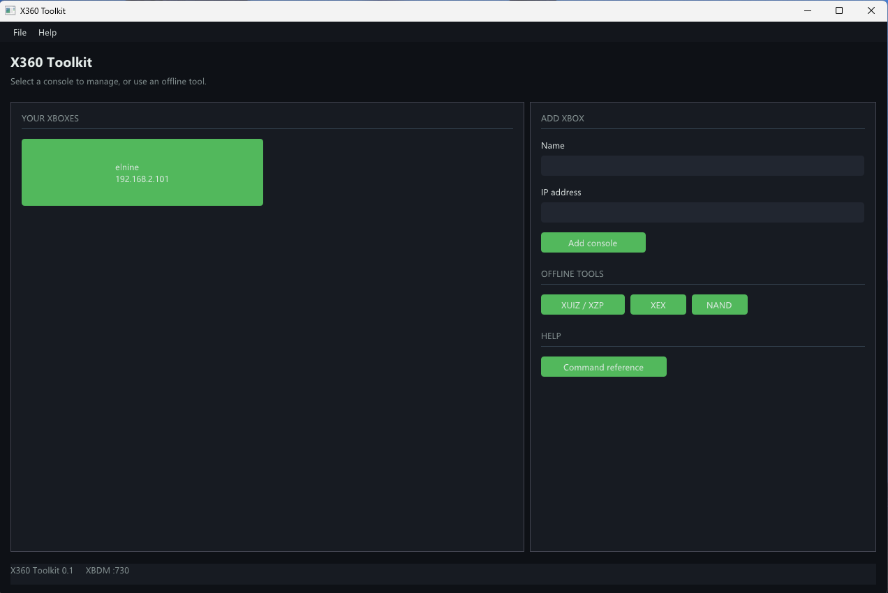
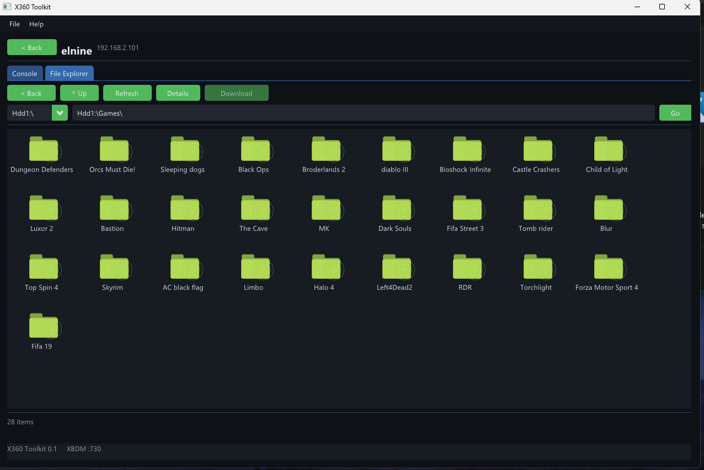
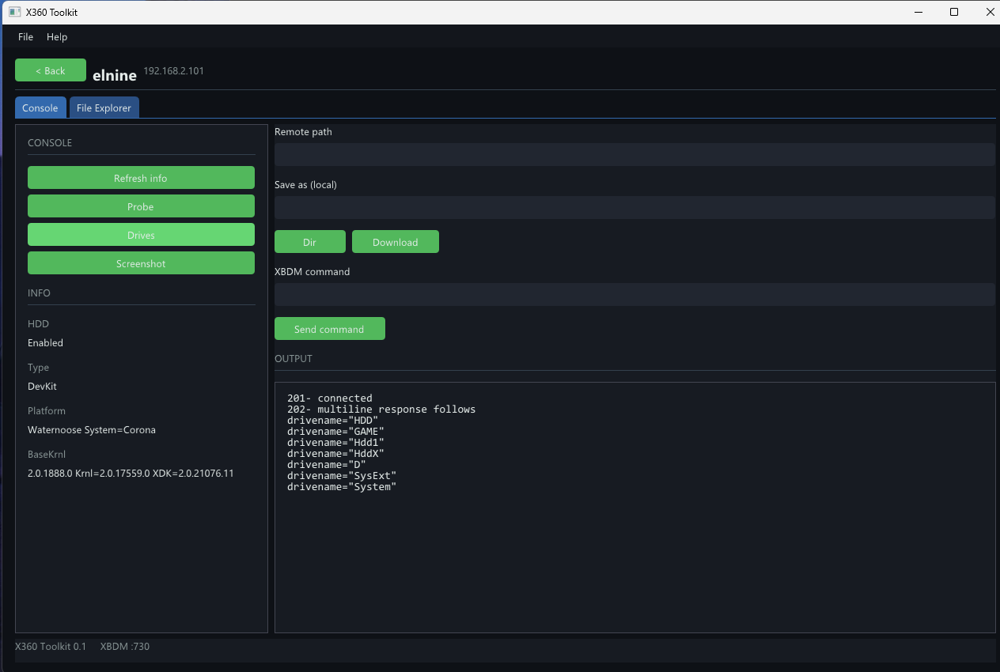
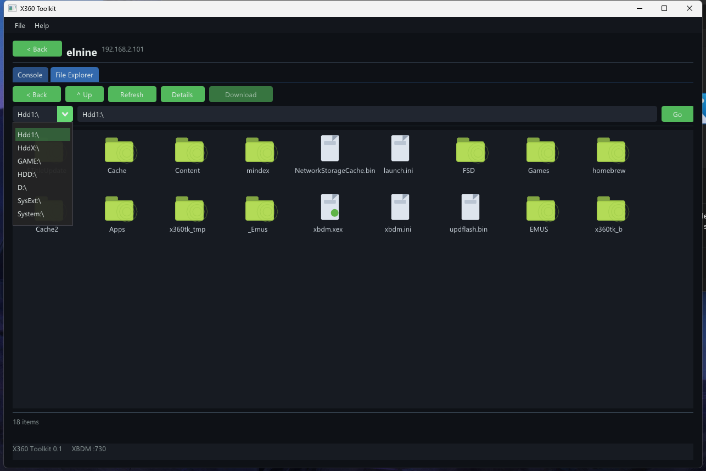
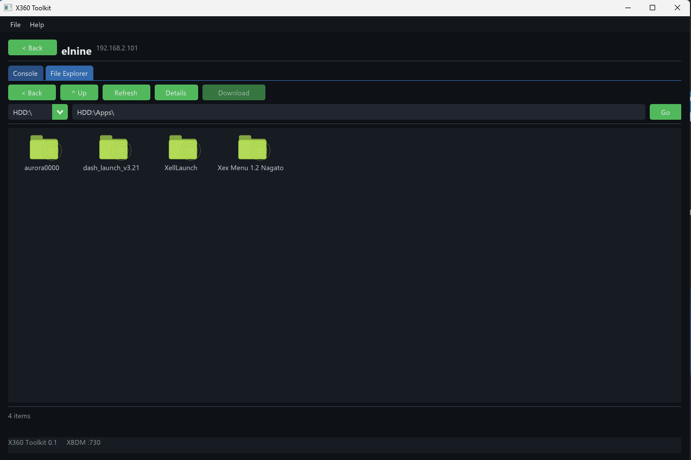
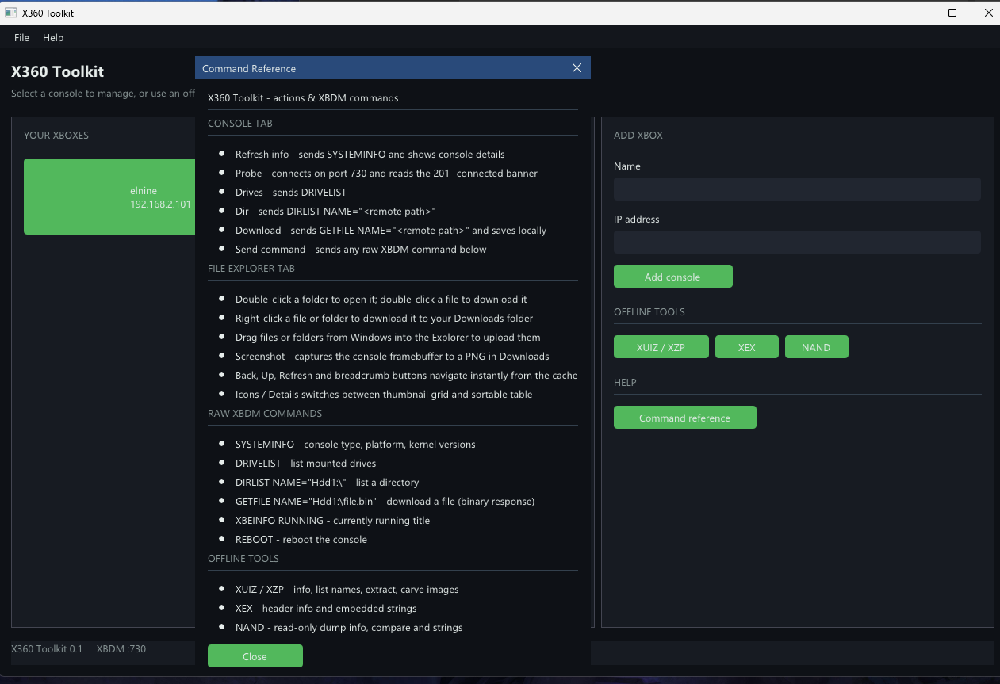

# X360 Toolkit

A Windows GUI application for managing a modded Xbox 360 over XBDM. It includes a fast file explorer for the console's drives and a few offline tools for common Xbox 360 file formats.

It talks to the console's XBDM debug monitor directly over TCP port 730. It does not use `xbdm.dll` and does not require the Xbox 360 Neighborhood shell extension.

## Screenshots



*Home screen: saved consoles, add console, and offline tools.*



*File explorer browsing a folder in icon view.*



*Console tab with SYSTEMINFO details and DRIVELIST output.*



*Drive selector in the file explorer.*



*Browsing the Applications folder.*



*Built-in command reference.*

## Features

### Console

- Connect to a console running XBDM (RGH/JTAG with Aurora, FSD, XeXMenu, etc.).
- Read console details with `SYSTEMINFO`.
- List mounted drives with `DRIVELIST`.
- Send any raw XBDM command and see the response.
- Capture a screenshot and save it as a PNG.

### File explorer

- Icon and details views, with a per-directory cache for fast navigation.
- Drag files or folders from Windows into the explorer to upload them.
- Right-click an item to open, download, rename, create a folder, delete, or copy its path.
- Right-click empty space to create a folder or refresh.
- Downloads are saved to the Windows `Downloads` folder.
- Upload and download progress is shown, and transfers continue in the background.
- Folder upload creates the remote directory tree before sending files.
- Folder delete is recursive.
- Screenshots are saved with the GPU framebuffer correctly untiled.

### Trainer

A Cheat Engine style memory scanner and editor for the running title, over XBDM. It has three sub-tabs: **Scanner**, **Address list** and **Memory viewer**.

- **Refresh target** reads the running executable name with `XBEINFO RUNNING`, the loaded modules with `MODULES`, and the mapped address ranges with `WALKMEM`.
- **Scanner**: pick a start address and length (or choose one from the module list), a value type and a value, then **First scan**.
  - First-scan types are **Exact**, **Unknown**, **Bigger**, **Smaller** and **Between**.
  - **Unknown** snapshots every value in the range, which is the way to find a value that is a bar rather than a number (health, stamina).
- **Next scan** re-reads the surviving addresses and filters them by **Exact**, **Bigger**, **Smaller**, **Between**, **Increased**, **Decreased**, **Increased by**, **Decreased by**, **Changed** or **Unchanged**. Each run is compared against the value captured by the previous run, and the results table shows the current value and the previous value side by side.
- Only mapped memory inside the window is read, in 256 KB chunks, so `GETMEMEX` is never asked for unmapped pages. A next scan only reads windows that still contain candidates, so it gets faster as the list narrows.
- Tick results (or click one) and **Poke** to write a value once, or **Add to list** to move them to the address list.
- **Address list**: a persistent list of addresses with their type and value. Tick **Freeze** to re-write that value about twice a second, edit a value in place, or **Poke** it once. The list is saved to `trainer_pins.txt` next to the executable.
- **Memory viewer**: a hex view of a page of memory. Go to an address, click a byte to select it, write space-separated hex bytes, or follow the dword under the cursor as an address.
- The trainer only reads memory. Nothing is written unless you press Poke, Write or tick Freeze. Writing to a running title can crash it, so only poke addresses you understand.

### Offline tools

- **XUIZ / XZP**: inspect skin packages, list entries, extract files, carve images.
- **XEX**: inspect XEX2 executable headers.
- **NAND**: read-only NAND dump information, comparison, and string search.

## How it is built

C++20 and Win32, with Dear ImGui (v1.93.1) rendered through DirectX 11. The result is a single window and a single executable with no console window.

- `src/core/XbdmClient.*` implements the XBDM text protocol directly over Winsock: `DIRLIST`, `GETFILE`, `SENDFILE`, `MKDIR`, `RENAME`, `DELETE`, `SCREENSHOT`, `SYSTEMINFO`, `DRIVELIST`, `XBEINFO RUNNING`, `MODULES`, `WALKMEM`, `GETMEMEX`, and `SETMEM`.
- `src/ui/GuiApp.cpp` contains the UI, the file explorer, the memory trainer and memory viewer, and the job runner.
- `src/modules/*` contains the offline tools, registered through a small `ITool` / `Registry` interface in `src/core/Tool.h`.
- Console work runs on a background job queue with four worker threads, so the UI never blocks on the network.
- Each transfer opens its own connection and writes to its own path, so switching directories during a transfer cannot corrupt it.
- Screenshots: the Xenos framebuffer is stored in 32x32 macro-tiles split into 8x8 micro-tiles. `screenshot()` reverses that tiling (equivalent to `XGAddress2DTiledOffset`), derives the surface width from `pitch`, and writes the BGRA pixels to a PNG.

## Why transfers are faster than Neighborhood

Neighborhood is a Windows shell namespace extension, so browsing and copying go through the shell's per-item metadata and synchronization path. This tool skips that layer and streams files straight to and from XBDM:

- Files are streamed in 64 KB chunks with `SENDFILE` and `GETFILE`, with no per-file shell round trip.
- Folder transfers use multiple worker threads, each file on its own connection.
- Directories are created on the console with `MKDIR` first, so uploads do not fail on missing parent folders.
- The only per-file overhead is the final status line, which arrives in a few milliseconds on a LAN.

On a local network, transfer speed is usually limited by the console's disk and network, not by the tool.

## Building

Requirements:

- Windows 10 or 11
- Visual Studio 2022 or newer with the **Desktop development with C++** workload
- The Windows 10/11 SDK, which is installed with that workload

Steps:

1. Open `xthree6ty.slnx`, or open `xthree6ty.vcxproj` directly.
2. Select the `x64` platform and `Debug` or `Release`.
3. Build.

All third-party code is vendored in `deps/imgui`. Nothing needs to be downloaded. The project links only Windows system libraries: D3D11, DXGI, Winsock, GDI+, Shell32, and Ole32.

Output:

```
x64\Debug\xthree6ty.exe
x64\Release\xthree6ty.exe
```

## Notes

- Tested on an RGH Corona console running Aurora with XBDM on port 730.
- This XBDM build answers `SYSTEMINFO`; `CONSOLEINFO` is not available on it.
- Files are deleted with `DELETE NAME="<path>"`; empty folders are removed with `DELETE NAME="<path>" DIR`. Folder deletion removes the contents first.
- The saved console list is stored in `consoles.ini` next to the executable.
- The trainer address list is stored in `trainer_pins.txt` next to the executable.
- The app is GUI only. There is no command-line mode.

## License

MIT. See `LICENSE`.